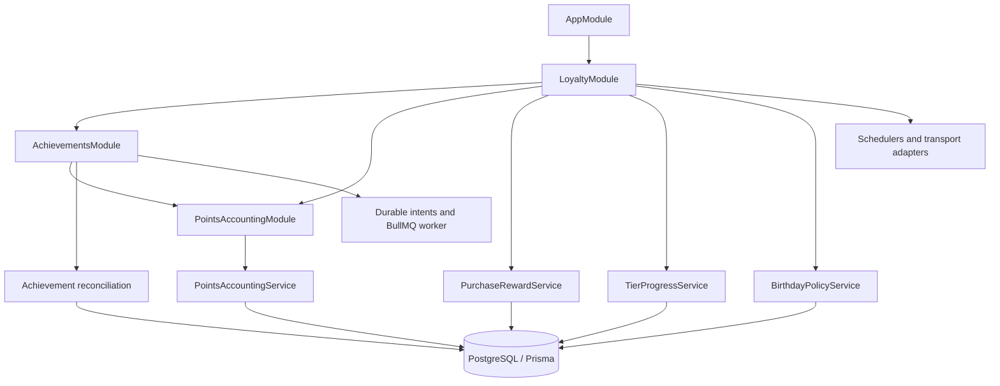

# Cinema Loyalty Service — Architecture Evolution & Business Rules Specification

Дата: 2026-10-23. Редакція: 2 — фіналізація бізнес-рішень.

Статус: **консолідовану специфікацію явно погоджено користувачем; реалізація не авторизована**.

Цей документ зберігає специфікацію з brainstorming. Редакція 2 включає індивідуально погоджені рішення H-1…H-16 та фінальне схвалення консолідованого підсумку: «так погоджую».

Це погодження дизайну й дозвіл оновити цей документ. Воно не означає дозвіл змінювати код, моноліт, контракти, виконувати міграції/reset, створювати коміти/PR або робити deployment. Кожен implementation stage погоджується окремо. Блокувальні бізнес-питання закриті; результати та неблокувальні технічні уточнення збережено в розділі H.

## Як використовувати цю специфікацію

- Це цільова модель, а не опис уже реалізованої економіки.
- Перед implementation task повторно перевірити HEAD, working tree, AGENTS.md і відповідні paths обох репозиторіїв.
- Джерела рішень: доступний підсумок попереднього brainstorming, явні повідомлення користувача, baseline завдання та подальше погодження рекомендацій. Повний дослівний протокол всіх відповідей «А/Б/В» не відновлювався.
- Нові явні рішення користувача мають перевагу над цим документом. Змінювати правила потрібно явно, разом із відповідними acceptance criteria.
- Тести під час підготовки специфікації не запускалися. Наявність тестів у коді не означає підтвердження їх проходження.
- Дані університетського проєкту disposable. Конвертація історичних клієнтських балансів не потрібна; реальних production customers немає. Reset потребує окремого дозволу.
- Технології зберігаються: NestJS 11, TypeScript, Prisma 7/PostgreSQL, Redis/BullMQ, RabbitMQ, gRPC, Bun 1.3.13, Node.js 22, Jest.

## A. Executive Summary

**Обраний напрямок — варіант B: поступова модульна еволюція всередині наявного NestJS застосунку.** Основна зміна — спільний облік походження балів, їх використання, повернення та боргу. Виділяти achievements в окремий мікросервіс або змінювати Express на Fastify зараз немає обґрунтованої потреби.

Поточна реалізація має основу, яку потрібно зберегти: profile locks, атомарний ledger, збережені результати deduct/refund, debit-linked refund, власника GOLD-квоти, durable achievement intents та RabbitMQ outbox із lease/fencing/recovery.

Нові правила не реалізуються лише зміною констант. Потрібні:

- авторитетні факти оплати, завершення сеансу та повернення;
- джерела нарахувань і розподіл списань між ними;
- облік боргу й кожного його погашення;
- незмінні умови винагороди конкретної покупки;
- кваліфікаційні внески за сеансами;
- birthday reservations і achievement entitlements.

### Перевірена локальна база

| Репозиторій | Гілка | HEAD | Working tree під час читання |
| --- | --- | --- | --- |
| cinema-loyalty-service | `master` | `db4b2f2ed28dd8c1bc71536ab3496cad73de892d` | Чистий за `git status --short` |
| cinema-platform-back | `fix/gold-checkout-compensation` | `7aa5a5c5f9e5bdf7ad0b69feb8e1e48b2681253d` | Чистий за `git status --short` |

Це SHA прочитаного коду, не нової наскрізної перевірки. Fetch, тести, міграції й запуск інфраструктури під час аналізу не виконувалися. Посилання та номери рядків нижче стосуються цієї бази й можуть змінитися.

## B. Recovered Business Decisions

Позначення джерел:

- **D** — відновлений підсумок попереднього brainstorming.
- **U** — явні розгорнуті повідомлення користувача.
- **B** — baseline завдання на специфікацію.
- **R** — рекомендація зі специфікації, прийнята подальшим погодженням користувача.
- **C** — поточний код; це доказ реалізації, а не джерело нових бізнес-правил.

### B.1. Points economy

| Питання | Фінальне правило | Джерело / уточнення |
| --- | --- | --- |
| Предмет нарахування | Лише квитки; їжа й напої не входять у MVP | D, B |
| База нарахування | Фактично сплачена грошима частина квитків | D |
| Змішана оплата | Використання балів не скасовує винагороду на грошову частину | D; змінює поточний код |
| Ставки | BRONZE 3%, SILVER 4%, GOLD 5% | D, B |
| Birthday multiplier | ×2 | D |
| Premiere/special multiplier | ×1,5 | D |
| Промо | Найбільший відповідний промомножник; birthday і premiere не перемножуються | D, B |
| Округлення | Вниз один раз після розрахунку винагороди | D, B |
| Ліміт покупки | 200 балів основної винагороди після множників | D; уточнює «200 base points» у B |
| Інші винагороди | Birthday gift та achievement rewards не входять у cap 200 | D |
| Конвертація redemption | 1 бал = 1 одиниця валюти платформи | D |
| Мінімальне списання | 25 балів | D, B |
| Максимальне списання | 50% відповідної суми замовлення | D, B |
| Доступність reward | Після завершення qualifying session, якщо покупка не повернена | D, B |
| Відвідування | Сканування квитка не потрібне; достатньо завершеного сеансу й чинної покупки | D |
| Умови reward | Tier, ставка, промо й birthday eligibility фіксуються перед конкретною спробою оплати; snapshot незмінний за своєчасного початку платежу | U; H-1, H-7; уточнює payment-time boundary |
| Час оплати | paidAt — час атомарного збереження монолітом підтвердженого успіху оплати разом із Paid та outbox; повтор не змінює його | U; H-1 |
| Delayed delivery | Не переобирає ставку, tier або birthday policy | D, B |

Без обмеження birthday budget формула основної винагороди:

```text
reward = min(200, floor(eligiblePaidAmount × tierRate × highestPromo))
```

Це округлення reward points, а не грошових сум до цілих. Для money потрібна точна десяткова арифметика або minor units за визначеною валютою. Не вводити BigInt/proto migration автоматично.

Прийнятий компроміс: per-order cap дозволяє отримати більше сумарно, розділивши велику покупку на кілька orders. Не замінювати його денним чи користувацьким лімітом без нового рішення.

### B.2. Expiry, refunds і bonus debt

| Питання | Погоджене правило | Джерело / межа |
| --- | --- | --- |
| Строк нарахування | 12 місяців від першої фактичної committed issuance джерела, не завершення сеансу | U; H-4 |
| Нові rewards | Не продовжують старі allocations | D |
| Порядок витрачання | FEFO: найближчий expiry першим, зі стабільним tie-breaker | D, B, R |
| Refund витрачених балів | Зберігає джерела й початкові строки | D |
| Прострочені повернені бали | Перше допустиме відновлення після original expiry відкриває один строк на 30 календарних днів Europe/Kyiv для всього початкового джерела | U; H-5 |
| Повторний restore | Не створює нові 30 днів або нові 12 місяців | D |
| Reversal reward | Повернення покупки відкликає відповідну основну винагороду, включно з промо | D, B |
| Уже витрачені reward points | Неповернена частина стає bonus debt | D, B |
| Available balance | Завжди невід’ємний | D, B |
| Погашення debt | Чинний available balance за FEFO, потім нові rewards і придатні restored points; після операції positive available та outstanding debt не співіснують | U; H-13; замінює future-rewards-only |
| Природа debt | Не грошовий борг; не блокує грошове повернення | D |
| Строк debt | Не спливає автоматично; контрольоване списання підтримкою можливе | D |
| Restore джерела debt | Узгоджується з уже створеним і погашеним debt; без подвійного стягнення | D |
| Expired reward | Не віднімається вдруге й сам по собі не створює debt | D, B |
| Extension identity | Один збережений deadline на source; наступні restored parts використовують його залишок. Restore до original expiry не витрачає право; після extension expiry новий строк не відкривається | U; H-5 |
| Звичайний refund | Нове погодження лише коли до StartTime понад 60 хвилин; рівно 60 хвилин і пізніше недоступне | U; H-16 |
| Admin refund | Виняток із причиною та actor, погоджений не пізніше 7 календарних днів Europe/Kyiv після scheduled EndTime | U; H-16 |
| Затримка refund | Строк обмежує нове погодження, не завершення/reconciliation вже погодженого refund. Підтверджений зовнішній refund враховується навіть за пізньої доставки | U; H-16 |

Redemption із кількох allocations дозволений. Часткові refunds у цей roadmap не входять: чинний checkout повертає повний пов’язаний debit.

Ризик bonus debt прийнято явно: це не гарантія повернення економічної втрати, якщо користувач більше не отримуватиме винагород. Не блокувати грошовий refund і не перетворювати debt на грошове стягнення. Expired/pending points не погашають debt. Спочатку узгоджується source-specific reversal/restore, потім погашається інший debt — без подвійного стягнення.

Перша issuance фіксується також для reward, одразу використаного на debt settlement. Відновлення не перезапускає 12 місяців. 30 календарних днів зберігають локальний час; отриманий UTC deadline записується один раз.

### B.3. Personal qualification periods і tiers

| Питання | Погоджене правило | Джерело |
| --- | --- | --- |
| Персональний рік | Річниця дати реєстрації о 00:00 Europe/Kyiv; перший період від фактичної реєстрації до наступної річниці | U; H-3; замінив rolling 12 months |
| Віднесення внеску | За часом завершення сеансу, не оплати чи доставки | D |
| Visit | Один user + один qualifying session = одне відвідування | D, B |
| Кілька orders/tickets | Не множать visit одного session | D |
| Квитки друзям | Уся відповідна грошова оплата враховується в spending покупця | D |
| SILVER | 12 сеансів OR 3600 грошових витрат | D, B |
| GOLD | 24 сеанси OR 7200 грошових витрат | D, B |
| Пороги spending | Фіксовані; не індексуються автоматично за ціною квитка | D |
| Reward points | Не є грошовими qualification metrics | D |
| Строк tier | Залишок року кваліфікації + наступний особистий рік, доки кваліфікаційна підстава чинна | U; H-2, H-11 |
| Після гарантії | Tier за відповідними metrics; можливий GOLD → BRONZE | D |
| Refund / factual correction | Перераховує metrics початкового особистого року та залежні grants; може понизити tier, але не скасовує інші чинні earned/manual grants | U; H-11; замінює безумовну гарантію |
| Видалення visit | Лише коли для session не залишилося qualifying contribution | D |
| Межі періодів | `[start, end)`; completion точно на межі належить новому року. Реєстрація 29 лютого → 28 лютого в невисокосний рік, без накопичувального зміщення | U; H-3 |
| Запізніла кваліфікація | Активує лише залишок первісного строку. Уже минулий grant виправляє історію без нового поточного grant | U; H-2 |
| Старі paid snapshots | Не переоцінюються через delayed qualification, refund або зміну tier після фіксації умов | U; H-1, H-2, H-11 |

Qualification period і lifetime achievement progress — різні часові масштаби. Не використовувати один лічильник для обох.

### B.4. Birthday policy

| Питання | Фінальне правило | Джерело / заміна |
| --- | --- | --- |
| Вікно | Лише birthday day | D; замінило birthday week |
| Timezone | Europe/Kyiv, не фіксований UTC offset | D |
| Birthday boundary | Snapshot/reservation підготовлено в birthday day; своєчасно розпочатий платіж може завершитися пізніше, session теж може бути пізніше | U; H-1, H-7; замінює вимогу завершити оплату саме цього дня |
| 29 лютого | У невисокосний рік — 28 лютого | D |
| Account age | Реєстрація не пізніше cutoff: початок birthday day мінус 30 календарних днів Kyiv; рівність дозволена | U; H-5 |
| DOB age | DOB встановлено не пізніше того самого 30-calendar-day cutoff | U; H-5 |
| Previous purchase | Є оплачена грошима, неповернена покупка, session якої завершився до birthday day | D |
| Eligibility | Snapshot станом на початок birthday day; не відкривається посеред дня | U, D |
| Спільні критерії | Одна eligibility для gift і multiplier | U, D |
| Gift | 25 балів за одну відповідну покупку з грошовою оплатою ≥150 | D |
| Частота gift | Один на birthday anniversary | U, D |
| Budget | До 100 додаткових birthday points на anniversary | D |
| Gift vs budget | Окремі: gift 25 не витрачає budget 100 | D |
| Reservation | Durable до початку конкретної payment attempt; 15 хвилин на її початок, unknown outcome потребує recovery | U; H-1, H-7 |
| Pre-issuance cancellation | Звільняє відповідне reservation | D |
| Post-issuance refund | Відкликає reward, не повертає consumed promo budget для нових orders | D |
| Gift після issuance/refund | Залишається використаним для цієї anniversary; другий gift не видається | R; конкретизація one-gift rule |
| Залишок budget менший за extra | Використати частину extra до залишку budget | R |
| Порядок budget allocation | Порядок успішного durable reservation, не RMQ delivery; звільнений budget доступний лише новим eligible orders | U; H-7, H-14 |
| DOB користувачем | Установлюється один раз | U, D |
| DOB correction | Через підтримку з історією; не створює нову anniversary entitlement | U, D |
| Дія correction | Для поточної річниці лише якщо нова дата ≥30 днів попереду і попереднє вікно річниці ще не почалося; інакше наступна річниця | D |
| Delayed historical facts | Авторитетно перевірити стан as of cutoff до списання грошей; відсутній доказ → temporary failure, підтверджена неeligibility → звичайні умови | U; H-8 |
| Multi-account | Неповний захист прийнятий; без KYC, паспортів і fingerprinting | U |

Birthday increment — різниця між reward з birthday і reward за те саме замовлення без birthday, але з premiere, якщо воно застосовується. Обидва розрахунки враховують floor і cap 200.

```text
normalReward = min(200, floor(paid × tierRate × nonBirthdayPromo))
birthdayReward = min(200, floor(paid × tierRate × max(nonBirthdayPromo, 2)))
requestedExtra = birthdayReward - normalReward
reservedExtra = min(requestedExtra, remainingBirthdayBudget)
purchaseReward = normalReward + reservedExtra
```

`remainingBirthdayBudget` читається й змінюється під чинним profile lock у транзакції reservation. Формула не дозволяє переобрати reservation під час повторної доставки. Gift має окрему state machine.

Приклад для GOLD і 2000 грошової оплати:

| Умови | Основна винагорода | Birthday increment |
| --- | ---: | ---: |
| Звичайна покупка | 100 | — |
| Premiere | 150 | — |
| Birthday без premiere | 200 | 100 |
| Birthday + premiere | 200 | 50 |

Максимум 125 birthday-specific points на eligible anniversary — це nominal extra 100 + gift 25, не cap усієї reward economy і не гарантія на фізичну особу.

### B.5. Achievements, GOLD і development data

| Питання | Погоджене правило |
| --- | --- |
| Monetary milestones | 12 qualifying sessions → 25; 24 → додаткові 50 |
| Період | Lifetime, не personal year |
| Інші achievements | Можуть бути косметичними, без points |
| Refund | Коригує source-linked progress; за втрати критерію entitlement відкликається |
| Requalification | Відновлює початкове право, не створює новий незалежний prize |
| Restore expiry | Початковий строк або те саме одноразове extension, без нового 12-місячного циклу |
| GOLD | Зберегти одну відповідну seat upgrade на UTC-місяць із ownership конкретного order |
| GOLD pricing | Зберегти чинний benefit: відповідне місце за Standard/base price; не безкоштовний квиток і не upgrade всіх tickets |
| Дані | Disposable test data; без історичної конвертації старих balances |
| Reset | Можна запропонувати; виконувати лише за окремим дозволом |

### B.5a. Admin operations, lifetimePoints і authoritative session facts

- `lifetimePoints` = видані rewards мінус відкликані rewards, з відновленням первісного entitlement при requalification. Redemption, expiry і debt settlement не зменшують цей показник; settlement не додає reward удруге. Pending не включається.
- Admin gift — окреме source-linked нарахування з actor, reason та persistent operation identity; 12 місяців від першої issuance, debt first, без visits/spending qualification. Correction первісної операції не маскується під новий gift.
- Manual GOLD — окремий grant на 12 місяців, без фіктивних metrics. Effective tier — найвищий із чинних grants; закінчення manual grant не видаляє earned grant. Exact replay не поновлює строк. Чинні GOLD order reservations зберігаються.
- Підтверджена системна помилка reward виправляється пов’язаною correction: надлишок відкликається, нестача донараховується. Перед admin correction показати вплив на balance/debt; compensation/forgiveness — окрема контрольована дія.
- Моноліт атомарно переводить нескасований session у Completed і створює authoritative fact. `completedAt = актуальний scheduled EndTime`, не час запуску scheduler. Completion, cancellation і reschedule узгоджують один session state.
- Звичайний reschedule можливий тільки до StartTime. Після початку — контрольована factual correction з actor/reason/revision; completed fact не переписується звичайним редагуванням. Затримка scheduler не розширює це вікно.

### B.6. Замінені альтернативи та межі погодження

- Birthday week ±3 дні замінено birthday day; згадки week у старих docs/proto не є цільовим правилом.
- Rolling 12 months замінено персональним роком від реєстрації.
- «200 base points» означає cap основної purchase reward після промомножників, не cap до них.
- Gift 25 не входить у birthday extra budget 100 або purchase cap 200.
- 30-денне extension спільне для початкового джерела, не окреме для кожного refund/requalification.
- Europe/Kyiv для birthday не змінює GOLD UTC-month rule.
- Попередня безумовна гарантія tier після refund скасована: чинність залежить від перерахованих qualification facts початкового періоду. Інші grants та frozen order snapshots збережені.
- Future-rewards-only погашення debt замінено погашенням також чинними available/restored points за FEFO.
- Payment-time freeze конкретизовано як pre-payment-attempt snapshot із 15-хвилинним строком початку, а не оцінка на момент доставки TicketPurchased.
- Погоджений дизайн не доводить фінансову прибутковість; фактичні margins, redemption rate і вартість GOLD benefit ще не виміряні.

## C. Current Architecture Assessment

### C.1. Сильні сторони

| Властивість | Доказ у перевіреній базі | Значення |
| --- | --- | --- |
| Transaction discipline | [profile-transaction.ts](../src/prisma/profile-transaction.ts), рядок 9 | READ COMMITTED, profile lock, bounded retry, переданий tx |
| Purchase atomicity | [loyalty.service.ts](../src/loyalty/loyalty.service.ts), рядок 275 | Profile, ledger, dedupe, tier outbox та intents разом |
| Historical RPC replay | [point-command-idempotency.ts](../src/loyalty/point-command-idempotency.ts), рядок 28 | Історичний result; conflicting payload відхиляється |
| Debit-linked refund | [loyalty-expiration.service.ts](../src/loyalty/loyalty-expiration.service.ts), рядок 249 | Одне повне повернення відповідного checkout debit |
| GOLD ownership | [schema.prisma](../prisma/schema.prisma), рядок 110 | Reservation history окрема від profile projection |
| Outbox recovery | [outbox-publisher.service.ts](../src/loyalty/outbox-publisher.service.ts), рядок 61 | Lease, fencing, crash attempts, backoff, SKIP LOCKED |
| Durable inbound handling | [rmq-delivery.service.ts](../src/loyalty/consumers/rmq-delivery.service.ts), рядок 68 | Budget переживає restart; ACK після commit/quarantine |
| Real PG regression base | [profile-concurrency.integration-spec.ts](../test/integration/profile-concurrency.integration-spec.ts), рядок 332 | Кероване перекриття writer-ів, rollback і dedupe |

Тести прочитані, але не виконані під час цього аналізу.

### C.2. Знахідки та класифікація

| Класифікація | Доказ | Наслідок і напрямок |
| --- | --- | --- |
| Доведене обмеження дизайну | `LoyaltyProfile`/`PointsTransaction` у schema, рядки 43/82 | Агрегованого balance недостатньо для FEFO і provenance restore |
| Доведене обмеження | `processTicketPurchase`, рядок 301 | Award одразу при purchase event; немає pending/session completion/snapshot |
| Доведене обмеження | `processTicketPurchase`, рядок 308 | Visit додається за order, а не unique session |
| Доведене обмеження | [loyalty-calculator.service.ts](../src/loyalty/loyalty-calculator.service.ts), рядок 64 | Birthday обчислюється з поточного часу обробки |
| Доведене обмеження | `resetAnnualStats`, рядок 168 expiration service | Calendar reset не зберігає personal periods/contributions |
| Доведене обмеження | [achievements.processor.ts](../src/achievements/processors/achievements.processor.ts), рядок 146 | Unlocked achievement пропускається; немає revoke/requalification |
| Доведене обмеження | Purchase; [admin-loyalty.service.ts](../src/loyalty/admin-loyalty.service.ts), рядок 118; achievement processor, рядок 191; expiry/refund | Accounting rules розподілено між writers; усі мають перейти на allocations |
| Архітектурне покращення | `LoyaltyExpirationService` | Expiry, notifications, annual reset, GOLD reset і refund мають різні причини зміни |
| Архітектурне покращення | [loyalty.module.ts](../src/loyalty/loyalty.module.ts), рядок 32; [achievements.module.ts](../src/achievements/achievements.module.ts), рядок 15 | Цикл через forwardRef; перевірені achievement providers не інжектять loyalty providers. Прибрати зайвий імпорт із DI regression |
| Доведене обмеження доставки | [achievement-intent-publisher.service.ts](../src/achievements/achievement-intent-publisher.service.ts), рядок 65 | deliveredAt означає enqueue, не завершену DB-обробку |
| Потенційний операційний ризик | Intent publisher, рядок 25 | Репліки можуть enqueue один intent; DB dedupe захищає ефект, але це не outbox lease semantics |
| Підтверджений кодом дефект notification delivery | `notifyExpiringUsers`, рядок 76 expiration service | Marker пишеться до publish; crash між ними залишає невідправлене повідомлення позначеним. Для нового expiry потрібен outbox |
| Доведене API-обмеження | `modifyPointsGrpc`, рядок 82 admin service | Немає operation/idempotency key; повтор після втрати відповіді не має гарантії одного ефекту |

Notification crash window встановлено за порядком коду, не новим runtime reproduction. Відмінності старих ставок/правил від майбутніх не називаються багами самі по собі. File length або кількість `if` не є доказом поганої архітектури.

### C.3. Межі моноліту

- `src/Modules/Orders/Cinema.Orders.Application/EventHandlers/OrderPaidIntegrationEventHandler.cs:67`: pattern TicketPurchased, eventId/orderId = order.Id, paidAmount і pointsUsed. PurchasedAt береться як DateTime.UtcNow під час handler; немає sessionId та immutable policy snapshot у envelope.
- `src/Modules/Identity/Cinema.Identity.Domain/User.cs:5`: немає авторитетних registeredAt/dobFirstSetAt. Loyalty profile.createdAt не є account registration timestamp.
- `src/Modules/Scheduling/Cinema.Scheduling.Domain/Entities/Session.cs:7`: є EndTime, Cancel і Reschedule. У перевіреному коді не знайдено завершеного reliable producer flow для session completion. Сам enum Ended не доводить існування flow.
- `src/Modules/Orders/Cinema.Orders.Application/Commands/CancelOrder/CancelOrderCommand.cs:85`: payment refund, restore spent points, GOLD rollback. Це не reward reversal fact.
- `src/Cinema.Infrastructure/ConfigureInfrastructureServices.cs:150`: уже є EF/MassTransit outbox. Використати його для facts, перевіривши атомарність конкретного producer path.
- OrderPaid handler пропускає надсилання loyalty event за відсутності user/email. Авторитетний paid fact не повинен залежати від можливості сформувати email notification.

## D. Proposed Target Architecture

### D.1. Module boundaries

Залишити LoyaltyModule та AchievementsModule. Один обґрунтований новий модуль — PointsAccountingModule: його providers потрібні обом. Purchase, tier і birthday спочатку залишити providers усередині LoyaltyModule.



Це залежності всередині одного deployable application, не окремі процеси чи databases.

### D.2. Власники відповідальностей

| Компонент | Інваріанти / відповідальність | Вхід → вихід, дані й залежності | Чому менше недостатньо |
| --- | --- | --- | --- |
| PointsAccountingService | Lots, FEFO, expiry, debt, settlements, reversal, ledger, balance projection | Переданий tx і source-linked command → accounting result; Prisma без network | Кілька writers мусять виконувати однакові правила |
| PurchaseRewardService | Payment facts, snapshot reference, pending reward, maturation, refund orchestration | Facts → entitlement/qualification/accounting; залежить від accounting, tier, birthday, achievement operations | Calculator не керує lifecycle і транзакціями |
| TierProgressService | Periods, spending contributions, unique visit, tier guarantees | Чинні facts → metrics/grants; Prisma, чисті calendar functions | Один yearPoints counter не представляє money та історичні periods |
| BirthdayPolicyService | Eligibility, anniversary identity, budget/gift ownership, correction policy | Customer/history/payment facts → eligibility/reservation; той самий tx | Policy має стан і concurrent budget, не лише multiplier |
| Achievements reconciliation | Progress, unlock/revoke, lifetime entitlement, restore | Поточна qualification → achievement state/accounting; не залежить від LoyaltyService | Increment-only worker не виправляє reordered/refunded contributions |
| Transport/background adapters | Validation, admission/retry, quarantine, dispatch, batch/wake-up | Message/job → domain operation | Не повинні самі визначати entitlement або balance |

LoyaltyCalculatorService залишається для чистих обчислень із явним часовим контекстом. LoyaltyService може залишатися фасадом чинного контролера. Не створювати service на кожен RPC і не переносити всі read methods без потреби.

### D.3. Концептуальна модель даних

Назви — пропозиції, не готова Prisma schema. Не кожна концепція обов’язково стане окремою таблицею.

| Концепція | Мінімальний зміст і constraints |
| --- | --- |
| Purchase reward / entitlement | userId/orderId/sessionId, paid fact, snapshot, expected reward, lifecycle state, source revision; unique purchase identity |
| Earning allocation | Source identity, issued amount, залишок, effective/expiry timestamps, entitlement reference, одноразове extension state |
| Debit allocation | Частина debit із конкретного earning allocation; FK на debit та source |
| Bonus debt і settlement allocation | Source reversal, outstanding amount, джерела та суми погашення; auditable restoration links |
| Order qualification contribution | Money і чинність конкретної покупки, sessionId і completion time |
| User/session qualification | Unique userId/sessionId; visit чинний, доки є qualifying contribution |
| Qualification period / tier grant | Межі personal year, metrics, підстава tier, інтервал і чинність grant; окремі earned/manual grants |
| Birthday anniversary/reservation | Stable anniversary, frozen eligibility evidence, gift state, reserved/consumed budget, order owner |
| Achievement entitlement | Unique userId/achievementId, original reward allocation, active/revoked state |
| Customer facts | Account registration, DOB first-set, correction revisions і business timestamps |

Pending reward і purchase entitlement можуть бути одним записом. Unique constraints захищають domain identity незалежно від transport eventId. Той самий source/revision з іншим payload — конфлікт, а не нове нарахування.

Ledger зберігається. Це не event sourcing: поточні таблиці стану залишаються робочою моделлю, ledger пояснює зміни. Міжрядкові рівності забезпечуються profile transaction і перевірками; не приписувати звичайному SQL CHECK можливість перевірити довільну суму інших рядків.

### D.4. Внутрішній accounting API

Умовні операції:

```typescript
grant(tx, source, entitlement)
redeem(tx, checkoutCommand)
restoreDebit(tx, checkoutRefund)
reverseEntitlement(tx, sourceReversal)
restoreEntitlement(tx, sourceRequalification)
expireDue(tx, userId, cutoff)
```

Вимоги:

- Один переданий Prisma.TransactionClient, profile lock уже взятий orchestrator-ом.
- Немає прихованих незалежних транзакцій чи зовнішніх network calls.
- Accounting не вирішує tier і не відкриває універсальний adjustBalance(delta) для обходу правил.
- Result можна атомарно зберегти як idempotency response.
- Усі writers — purchase, refund, expiry, birthday, achievement, admin — використовують цей облік.

Top-level orchestrator володіє transaction boundary. Accounting володіє правилами зміни балів усередині неї.

### D.5. Transaction boundaries

#### Redemption

```text
profile lock
→ exact replay / conflicting payload check
→ expireDue на актуальному захищеному стані
→ settle outstanding debt чинними allocations
→ sufficiency check
→ FEFO allocations
→ balance + ledger + checkout debit + command result
→ commit
```

FEFO: стабільний порядок expiresAt, id. Прострочені allocations не spendable до нічного scheduler tick. Read/preview повинні враховувати реальну доступність, а не сліпо cached balance.

#### Purchase maturation

```text
profile lock
→ dedupe і authoritative source state
→ payment + completion + refund checks
→ pending entitlement transition
→ accounting grant/debt settlement
→ qualification contribution + tier
→ birthday reservation consumption
→ related outbox/intents
→ commit
```

#### Refund / source reversal

```text
profile lock
→ source identity/revision/replay
→ cancel pending або reverse issued reward
→ restore checkout debit за його allocations
→ correct qualification початкового періоду та залежні tier grants
→ reconcile monetary milestone achievements
→ settle remaining debt придатними available/restored points
→ ledger + debt links + outbox/intents
→ commit
```

Погоджена рекомендація: необхідне відкликання двох monetary milestone rewards виконується в тій самій refund transaction. Не залишати відоме завищення балансу до наступного BullMQ job.

Achievement worker використовує ту саму reconciliation operation: відкриває top-level transaction, бере profile lock, читає актуальні contributions. Старий job не застосовує старий increment як істину й не resurrect-ить revoked qualification. Durable intents зберігаються як механізм доставки/recovery; вони не стають другим власником accounting.

#### Lock order

```text
profile
→ operation/source records
→ allocations/debts у стабільному порядку
→ progress/reservations
→ ledger/outbox/intents
```

Одна transaction змінює одного користувача. Session-wide jobs не утримують profile locks усіх клієнтів разом. Існуючий bounded retry залишається; callback містить лише DB work.

### D.6. Приклад, який обґрунтовує debt settlement links

1. Покупка A дала 25 points.
2. Усі 25 витратили на B.
3. A повернули → debt 25.
4. Reward C10 погасив частину → outstanding debt 15.
5. B повернули.

За умови чинного строку C результат: debt 0, available C10. Outstanding 15 скасовується, funding C10 звільняється з попереднього settlement із власним expiry. Недійсні A25 не відновлюються як spendable points. Якщо є інший debt, C10 погашає його за H-13. Кожна компенсувальна дія має посилання на попередню allocation/settlement.

Якщо спочатку відкликати C, його settlement скасовується і outstanding A повертається до 25, без другого незалежного боргу за ті самі C10. Наступний refund B дає debt 0, available 0. Інший допустимий порядок тих самих фактів має дати еквівалентний результат. Звільнення C не відкриває нові 12 місяців; діють його первісний expiry і спільне одноразове extension. Один агрегований debtBalance цього не пояснює.

### D.7. Payment snapshot і reservation lifecycle — погоджений протокол

Async TicketPurchased підтверджує paid fact, але не створює snapshot заднім числом. До початку конкретної payment attempt зберігаються policy version, tier/rate/promo, eligibility evidence, expected reward та birthday reservation з order/attempt ownership і `policyFixedAt`.

1. Підготовка дає 15 хвилин на початок платежу. Exact replay не пересуває deadline.
2. Якщо платіж не почато вчасно, reservation звільняється; продовження потребує нового snapshot за актуальними умовами.
3. Початок платежу і expiry/release узгоджуються durable transitions. Факт початку зберігається до network call; recovery має враховувати crash у цьому проміжку. DB locks не тримаються під час мережі.
4. Своєчасно почата спроба зберігає snapshot до визначеного outcome. Timeout/Unknown сам по собі не дозволяє release; потрібне authoritative reconciliation. Confirmed decline звільняє резерв.
5. `paidAt` записується один раз, коли моноліт атомарно зберігає confirmed success, Paid і outbox. При пізньому підтвердженні Unknown це час такого збереження, не вигаданий provider timestamp; він відрізняється від policyFixedAt.
6. До charging birthday evidence перевіряється as of birthday-day cutoff. Невизначеність дає temporary error, а не мовчазну відмову в бонусі. Network verification виконується поза DB transaction.

Приклад: snapshot у birthday day о 23:59, своєчасний початок платежу о 00:02 наступного дня — birthday conditions збережено. Нерозпочата до deadline спроба потребує нових умов. Звільнений бюджет не доповнює вже оплачені orders і не подовжує birthday day.

Transport names і конкретні recovery endpoints визначаються в implementation task; їх результат має відповідати цьому lifecycle. Реалізація починається лише за окремим дорученням.

## E. Business Invariant Catalog

U — unit; PG — реальний PostgreSQL; T — real transports; E2E — обидва сервіси.

| ID | Інваріант | Власник | Перевірка |
| --- | --- | --- | --- |
| I-01 | Available balance невід’ємний і відповідає доступним залишкам allocations | Accounting | PG, property-based U |
| I-02 | Одна частина points не є одночасно available, spent і debt settlement | Accounting | PG |
| I-03 | Debit = сума його allocations; стабільний FEFO | Accounting | U, PG concurrency |
| I-04 | Expired allocation не spendable до scheduler tick | Accounting | PG expiry/debit race |
| I-05 | Exact command replay повертає historical result; інший payload відхиляється | Commands | PG, gRPC T |
| I-06 | Повтор source не створює друге entitlement/ledger/debt effect | Purchase/accounting | PG, RMQ T |
| I-07 | Full checkout refund прив’язаний до одного debit і не дублюється іншим ключем | Refund/accounting | PG, E2E |
| I-08 | Reversal не віднімає вдруге expired/reversed частину | Accounting | U, PG |
| I-09 | Кожен debt має source, кожне погашення — funding source | Accounting | PG |
| I-10 | Чинні available points за FEFO, нові rewards і придатні restores гасять debt; positive available та debt після операції не співіснують | Accounting | U, PG |
| I-11 | Restore/requalification не створює другого призу чи подвійного відшкодування | Accounting/achievements | PG |
| I-12 | Перше допустиме відновлення після original expiry відкриває один deadline на 30 Kyiv calendar days для всього source; повтор не пересуває його | Accounting | U calendar, PG concurrency |
| I-13 | Без confirmed payment і qualifying completion reward недоступний | Purchase | U, PG, E2E |
| I-14 | Delivery time не змінює суму/snapshot чи qualification period; first issuance визначає expiry, delayed tier — лише залишок первісного строку | Purchase/tier/accounting | U, PG, T |
| I-15 | Pre-payment-attempt snapshot незмінний за своєчасного початку; Unknown не звільняє reservation; paidAt стабільний | Purchase/birthday/monolith | PG, E2E |
| I-16 | Один user/session дає максимум один чинний visit | Tier | PG |
| I-17 | Spending — money, не reward points | Tier | U, PG |
| I-18 | Refund/correction перераховує підстави grants початкового періоду; інші чинні grants, frozen orders і GOLD reservations не скасовуються | Tier | U, PG, E2E |
| I-19 | Birthday eligibility перевірена as of Kyiv anniversary cutoff; account/DOB age ≥30 calendar days, unknown evidence не допускає charging | Birthday/checkout | U, PG, T |
| I-20 | reservedExtra + consumedExtra ≤100; gift окремий і не дублюється | Birthday | PG concurrency |
| I-21 | Post-issuance refund не повертає consumed budget/gift для нової покупки | Birthday | PG |
| I-22 | DOB correction не створює друге anniversary entitlement | Birthday/customer facts | PG, T |
| I-23 | Monetary achievement entitlement один за життя на user/achievement | Achievements | PG |
| I-24 | Delayed achievement job перевіряє чинну qualification | Achievements | PG, BullMQ T |
| I-25 | Profile/accounting/dedupe/related outbox-intents атомарні | Orchestrators | PG fault injection |
| I-26 | Немає зовнішніх викликів у retried DB callback | Усі writers | Review, fault tests |
| I-27 | Старий outbox owner не змінює successor claim | Outbox | PG process restart |
| I-28 | ACK після business commit або durable quarantine | Inbound | RMQ T |
| I-29 | GOLD rollback звільняє лише відповідний order reservation | GOLD | Existing PG/T regressions |
| I-30 | Втрата Redis job не видаляє authoritative reward/qualification state | Background | PG + Redis T |
| I-31 | lifetimePoints = issued − revoked + restored entitlements; spending/expiry/settlement не змінюють його як нову винагороду | Accounting | U, PG |
| I-32 | Refund admission дотримується >60 хвилин/admin 7 calendar days; строки не блокують завершення погодженого чи облік підтвердженого refund | Monolith/refund ingestion | U, backend PG, E2E |
| I-33 | Completion time = authoritative scheduled EndTime; normal reschedule тільки до StartTime, corrections revisioned | Monolith/session lifecycle | U calendar, backend PG, T |

I-01 потребує явних read semantics: cached profile balance може вимагати expiry-актуалізації; API не повинен видавати stale projection за guaranteed spendable balance.

## F. Detailed Roadmap

Вісім етапів зберігаються. Немає окремого великого refactor stage: зміни відповідальностей виконуються разом із відповідними правилами. PR boundaries нижче практичні, а не обов’язкова кількість PR.

### Етап 1. Authoritative business facts і contracts

**Проблема:** бракує фактів для payment policy, completion qualification та birthday age.

**Правила/scope:** зберегти immutable confirmed paid fact з user/order/session identity, money, pointsUsed і business timestamp; додати registration/DOB timestamps та corrections revision; визначити reliable completion/refund facts; відділити occurredAt від publishedAt/receivedAt.

**Target responsibilities/data:** моноліт — source of truth account/order/session; loyalty — потрібна проєкція з source identity/revision. Не вигадувати timestamps зі створення loyalty profile або доставки.

**Файли:** backend Order/User, EF configurations, OrderPaidIntegrationEventHandler, DOB handlers, session lifecycle, cancellation. Loyalty purchase/DOB DTOs, consumers, schema facts models.

**Контракти:** мінімальні доповнення envelope; окремі completion/refund facts. Точні names/versions затвердити до реалізації. Deduct/refund/GOLD RPC не перевизначаються.

**Інваріанти:** I-06, I-14, I-25, I-28.

**Failure/concurrency:** completion/refund перед purchase; той самий source/revision з іншим payload; delayed DOB revision; DB commit до broker delivery; crash producer.

**Тести:** unit validation; backend PG outbox atomicity; loyalty PG identity/revision; real RMQ round-trip; E2E pinned SHA pair.

**Acceptance:** stable identity/business time, exact replay, conflicting content відхиляється; дані не підміняються now; rollback не залишає publishable success fact.

**PR boundaries:** (1) immutable payment facts і чинний envelope; (2) customer timestamps/DOB revisions; (3) completion/refund lifecycle та loyalty ingestion як узгоджені PR двох репозиторіїв.

**Уточнення H-1/H-10/H-16:** paidAt — confirmed Paid commit time; completedAt — authoritative EndTime. У lifecycle PR розділити durable погодження refund і його outcome; застосувати >60 хвилин та admin 7 Kyiv calendar days. Перевірити completion/cancel/reschedule races та неможливість ordinary reschedule після StartTime. Ці зміни не розширюють перший вузький paid-facts PR автоматично.

**Залежності:** немає; бізнес-семантику погоджено. **Виключено:** rates, awards, FEFO, UI. **Ризик:** schema сама не створює авторитетний факт; його треба записувати в правильному transition.

### Етап 2. Allocations, FEFO, redemption, expiry

**Проблема:** balance не пояснює, які points витрачені.

**Правила/scope:** earning/debit allocations; FEFO; source-preserving full refund; per-allocation expiry; погоджена expiry/extension formula; усі balance writers через accounting; expiry notifications через outbox.

**Target:** PointsAccountingModule; transaction ownership лишається в orchestrator. Refund переноситься з expiration service у відповідний checkout/accounting path.

**Файли/data:** schema/migrations; loyalty, expiration, admin services; achievement processor; controller delegation; batch tests; earning/debit allocations та links до чинних checkout debits.

**Моноліт/contracts:** command identity deduct/refund зберегти. Узгодити read модель кількох expiry: старе balanceExpiresAt не описує весь баланс.

**Інваріанти:** I-01–I-05, I-07, I-12, I-25.

**Failure/concurrency:** deduct/expiry, два deductions, restore/expiry, concurrent restore одного lot, failure між allocation і ledger.

**Тести:** FEFO unit; PG locks/constraints; 500/501/1001 batch traversal; gRPC historical replay; всі writer paths; допустимі numeric bounds.

**Acceptance:** жоден writer не обходить allocations; expired не spendable; refund відновлює правильні sources; partial redemption не губить залишки; ledger/profile/allocation rollback разом.

**PR boundaries:** accounting model + grant/redeem/restore з усіма writers; за потреби окремо expiry/notification outbox/read semantics. Не активувати неповний комплект у спільному стенді.

**Уточнення H-4/H-5/H-9:** expiry від first issuance; restore не перезапускає 12 місяців; перший post-expiry restore відкриває один спільний 30-calendar-day deadline. Перевірити частини restore до/після deadline, leap/DST і replay. Усі writers, включно з admin gifts, підтримують net lifetimePoints; stage 3 додає його reversal/debt transitions.

**Залежності:** stage 1 source identities, погоджені H-4/H-5. **Виключено:** debt, нові rates, partial refunds. **Ризик:** пропущений admin/achievement writer порушить balance equality.

### Етап 3. Reward reversal і bonus debt

**Проблема:** немає коректного представлення refund source після витрати reward.

**Правила/scope:** revoke entitlement з available/spent/expired/reversed частинами; source-linked debt; погашення чинними available points за FEFO, новими rewards і придатними restores; корекція settlements при debit refund/requalification; preserve full debit-linked checkout refund.

**Target/data:** debt/settlements в accounting; source reversal визначає purchase orchestrator. Не створювати універсальну accounting platform.

**Файли:** accounting providers/models; refund orchestration; purchase refund consumer; admin adapter лише для погоджених support operations.

**Моноліт/contracts:** confirmed refund fact; unknown refund/payment outcome не прирівнюється до refund success. Розрізняти restoration витрачених балів та reversal зароблених.

**Інваріанти:** I-07–I-11, I-25.

**Failure/concurrency:** A/B refunds у різному порядку; reward C погасив debt і теж reversed; earning/refund concurrency; replay після lost ACK; settlement rollback.

**Тести:** табличні unit examples; PG conservation і fault injection; RMQ reorder; E2E earn → spend → refund source → refund spend.

**Acceptance:** допустимі порядки доставки сходяться до еквівалентного економічного стану; кожен debt/settlement має source; немає подвійного стягнення чи повернення. Після операції positive available/debt не співіснують. Приклад D.6 та його альтернативний порядок перевіряються на PG; expired частини не стягуються повторно, funding reversal не створює подвійний debt.

**PR boundaries:** accounting reversal/debt/settlements з PG coverage; підключення authoritative refund flow і E2E.

**Залежності:** 1–2. **Виключено:** cash collection, partial refunds. **Ризик:** aggregate-only debt недостатній; зворотні settlements потребують окремого уважного review.

### Етап 4. Post-screening earning і нова economy

**Проблема:** поточний consumer одразу видає reward за поточними умовами.

**Правила/scope:** pending → issued/cancelled; issued → reversed; ticket-only paid money; 3/4/5%, highest promo, floor, cap 200; mixed-payment earning; minimum redeem 25/maximum 50%; immutable snapshot.

**Target/data:** PurchaseRewardService і чистий calculator; pending state у PG; completion запускає maturation. BullMQ job — wake-up, а scanner відновлює роботу з DB після втрати jobs.

**Файли:** purchase service/DTO, calculator/constants, schema, scheduler/processor; backend checkout/payment facts.

**Контракти:** погоджений snapshot/authorization protocol із D.7. Чинний preview не є reservation. DB transaction не охоплює payment RPC.

**Інваріанти:** I-13–I-15, I-25, I-30.

**Failure/concurrency:** tier змінився між pay/end; completion прийшов першим; refund перед maturity; worker crash; reschedule; unknown payment; delayed confirmed event.

**Тести:** unit rates/caps/rounding; PG maturity/refund race; Redis recovery; E2E before-end і delayed delivery.

**Acceptance:** reward до completion недоступний; після — один ефект за snapshot; pre-issuance refund не створює reward/debt; delayed delivery не змінює ставку.

**PR boundaries:** pending lifecycle/snapshot contract; new calculator/redemption та завершена checkout integration.

**Уточнення H-1/H-7:** тестувати tier/date change після snapshot, початок перед deadline/на межі, повтор prepare без продовження строку, crash перед network call, Unknown і delayed confirmation. Своєчасно початий платіж не втрачає умови після 15 хвилин; відновлення не залежить лише від Redis job.

**Залежності:** 1–3 і погоджені H-1/H-7. **Виключено:** повний birthday policy і tier lifecycle. **Ризик:** не активувати цей stage зі старими несумісними tier/promo assumptions.

### Етап 5. Personal periods і tier lifecycle

**Проблема:** calendar reset/reward-point thresholds не відповідають новій qualification.

**Правила/scope:** registration anniversary periods Europe/Kyiv; completion-time contributions; unique user/session visits; 12/3600 і 24/7200; grants на залишок року кваліфікації + наступний рік за чинної підстави; refund/factual correction перераховує залежні grants початкового періоду. Manual GOLD — окремий 12-місячний grant.

**Target/data:** TierProgressService, contribution records, period metrics, tier grants/history. yearPoints не стає money мовчки.

**Файли:** calculator, annual reset path, scheduler, profile mapper/proto read model, purchase/refund orchestration.

**Моноліт/contracts:** registration/session facts; узгодити нові read fields і consumers. Якщо потрібні downgrade notifications, визначити їх окремо, не надсилати downgrade як TierUpgraded.

**Інваріанти:** I-14, I-16–I-18.

**Failure/concurrency:** два orders/session; refund останнього qualifying order; completion на межі року; late closed-period facts; upgrade перед expiry; повтор scheduler.

**Тести:** calendar unit з controlled clock; PG concurrent contributions; transport reorder; E2E tier change без зміни paid snapshot.

**Acceptance:** period deterministic; money/points окремі; grant не подовжується кожним tick; refund не видаляє чужий contribution/visit. Перевірені Feb29 registration, completion точно на межі, delayed попередній рік, відкликання GOLD до SILVER/BRONZE за залишковими metrics, незалежні earned/manual grants. Інші frozen orders та GOLD ownership не змінюються. Renewal обліковується також коли користувач уже має відповідний tier.

**PR boundaries:** contributions/personal metrics; grants/renewal/downgrade/read API.

**Залежності:** 1, 3–4, погоджені H-2/H-3/H-9/H-11. **Виключено:** GOLD benefit redesign. **Ризик:** current metrics не замінюють історичну підставу grant; пізній факт не створює зайвий рік.

### Етап 6. Birthday eligibility, budgets і corrections

**Проблема:** чинний grant не має eligibility evidence або budget ownership.

**Правила/scope:** Europe/Kyiv day, Feb29; account/DOB age; prior completed purchase; frozen eligibility; extra 100 і gift 25/payment150; частковий extra до залишку; order ownership; release до issuance/consumed після; support corrections.

**Target/data:** BirthdayPolicyService; anniversary state, evidence references, per-order reservations; snapshot references revision. Anniversary identity не можна перевизначити новою DOB задля нового budget.

**Файли:** DOB consumer/service, birthday scheduler replacement, calculator, purchase/refund orchestration, facts/contracts; backend support correction path.

**Контракти:** snapshot/reservation protocol; customer revisions; stable identity. Не змінювати GOLD UTC через birthday timezone.

**Інваріанти:** I-19–I-22.

**Failure/concurrency:** parallel orders, unknown payment, pre/post-issuance refund, old DOB after correction, Dec/Jan, DST, leap day, session наступного року, lost response reservation.

**Тести:** unit calendar/eligibility; PG budget/gift race; real transport revisions; E2E reserve → delayed award → refund.

**Acceptance:** correction не створює budget; gift/extra окремі; eligibility не відкривається mid-day; frozen orders не переобирають правила; exact reservation replay зберігає result. Перевірені рівність 30-day cutoff, DST, missing evidence до charging, snapshot 23:59/payment start 00:02, recovery Unknown, release нерозпочатої спроби та відсутність retroactive top-up інших paid orders. Звичайна контрольована DOB correction зберігає вже обіцяні snapshot benefits; підтверджена окрема системна помилка виправляється за H-11.

**PR boundaries:** anniversary/eligibility/DOB policy; checkout reservations і lifecycle.

**Залежності:** 1–5, payment protocol. **Виключено:** KYC/fingerprinting, гарантія на одну фізичну особу. **Ризик:** multi-account abuse обмежений, не усунений; historical evidence reconciliation потрібна явно.

### Етап 7. Achievements progress/revoke/requalification

**Проблема:** increment-only progress не враховує refunds.

**Правила/scope:** 12/24 lifetime unique qualifying sessions; 25/50 reward; source-linked progress; lifetime entitlement; revoke/restore через accounting; worker reads current truth.

**Target:** той самий deployable service. Reconciliation приймає tx; monetary corrections включаються в refund transaction. Durable intents і existing dedupe збережені.

**Файли/data:** processor/service, helper, schemas, entitlement models/definitions, purchase/refund orchestration. Не переписувати unrelated cosmetic achievement rules.

**Моноліт/contracts:** використовує попередні facts; новий microservice/broker не потрібен.

**Інваріанти:** I-11–I-12, I-23–I-25, I-30.

**Failure/concurrency:** unlock/spend/refund/debt/repayment/requalify; expired reward; old job після revoke; duplicate/redelivery; repeated threshold crossing.

**Тести:** unit transitions; PG settlements/reversal atomicity; BullMQ restart/duplicates; E2E lifetime milestones across personal years.

**Acceptance:** немає другого independent prize; restore враховує debt/settlements/expiry; stale job не resurrect-ить нечинну qualification; progress відтворюється з внесків.

**PR boundaries:** source progress/entitlements; revoke/restore/recovery за потреби окремо.

**Залежності:** 2–5 і extension semantics. **Виключено:** universal achievement engine, окремий deployable service. **Ризик:** refund впливає лише на achievements з відповідним джерелом.

### Етап 8. Cross-service verification і activation

**Проблема:** зелені unit/component tests не доводять цілий distributed lifecycle.

**Scope:** payment → completion → reward → redeem → refund → restore; read API available/pending/debt/tier/expiry; recovery/replay; clean development baseline.

**Target/files:** чинні integration/transport runners, fixtures, mappers, CI, наявна setup/reliability документація. Не додавати нову інфраструктуру заради test orchestration.

**Контракти:** фінальна .NET/proto/events перевірка. Старі поля не отримують новий прихований зміст. Frontend/UI implementation поза цим roadmap, але API має бути пояснюваним для клієнта.

**Інваріанти:** весь каталог E, з existing GOLD/idempotency/outbox regressions.

**Failure scenarios:** broker/Redis unavailable, worker kill/restart, lost ACK/response, reordered facts, unknown payment, boundary dates.

**Тести:** усі рівні F.9; sequential disposable harness runs; pinned pair SHAs, container versions і cleanup.

**Acceptance:** 0 failures і exit code 0 кожного runner; немає accounting bypass writer; repeated messages converge; описані зовнішні межі й mock payment behavior.

**PR boundary:** integration/activation PR на сервіс із фактичними результатами.

**Залежності:** 1–7 та закриті blocking H. **Виключено:** production deployment/readiness certification. **Ризик:** mock payment не перевіряє реального provider-а; прибутковість окремо.

### F.9. Test and integration strategy

| Рівень | Що доводить | Приклади |
| --- | --- | --- |
| Unit | Детерміновані правила | Rates, floor/cap, birthday delta, periods, entitlement transitions |
| PostgreSQL integration | Атомарність і concurrency | FEFO/expiry, debt settlements, budget races, rollback |
| Real transports | Фактична доставка | RMQ ACK/quarantine/replay, gRPC status/result, BullMQ duplicates/restart |
| Cross-service E2E | Цілий lifecycle | Checkout → completion → reward → redemption → refund → restore |

Обов’язкові сценарії:

1. Payment до completion: pending, available незмінний.
2. Refund до completion: reward не видається.
3. Refund після витрати reward: debt без negative available.
4. Partial redemption із кількох lots; refund відновлює джерела.
5. FEFO/expiry/debit реально перекриваються.
6. Completion/refund перед purchase.
7. Tier change між payment і completion.
8. Birthday payment наприкінці року, completion наступного; anniversary budget не губиться.
9. Кілька orders на один session.
10. Achievement revoke/requalification після debt settlement і expiry.
11. Crash після claim/commit/enqueue, до response/ACK.
12. Exact command replay та conflicting payload.
13. Restoration після вичерпання одноразового extension не продовжує строк знову.
14. Reversal reward, який був funding source для погашення іншого debt.
15. Pre-payment snapshot, 15-minute initiation deadline та crash/Unknown без необґрунтованого release.
16. Доступні points гасять debt за FEFO; приклад D.6 в альтернативних порядках, зі збереженням expiry.
17. Refund перераховує grants початкового року, не скасовуючи інші grants, frozen orders або GOLD ownership.
18. Ordinary refund >60 хвилин: точно 60 і менше відхиляється; admin 7 Kyiv calendar days: межа включна; вже погоджений refund завершується після неї.
19. Normal reschedule до StartTime, completion за EndTime, revisioned correction після початку.
20. First issuance визначає 12-місячний expiry навіть при затримці або негайному debt settlement; replay не пересуває строк.

Для PG concurrency потрібні barriers/locks і підтверджене перекриття; одного Promise.all недостатньо. Не підміняти PG SQLite/mocks. Controlled adapters допустимі для точного fault injection, але не замінюють transport suite.

Pair SHA потрібна для E2E і transports із backend checkout. Standalone loyalty PG/RMQ tests фіксують loyalty SHA та container versions. Не використовувати попередній green run як доказ нового head.

Майбутні команди за package.json:

```text
bun run test --runInBand
bun run test:integration
bun run test:rmq
bun run test:transports
bun run build
bun run lint
bun run buf:lint
bun run buf:build
```

Proto checks потрібні при зміні proto. Install/codegen — тільки коли потрібні, за актуальним workflow. Host scripts використовують Bun 1.3.13, application runtime — Node.js 22, tests — Jest. Infrastructure-dependent runs послідовні й disposable. Звітувати exact exit codes, failures, skipped/blocked і cleanup; не заявляти CI без його фактичного запуску.

Ці команди не запускалися під час підготовки документа.

### F.10. Migration та coordinated activation

1. Schema/contracts реалізуються інкрементально і перевіряються на disposable DB.
2. Не робити backfill старих test balances у lots.
3. Не підтримувати dual-write/dual economy лише заради старих даних.
4. До активації підготувати всі writers і потрібні contracts.
5. Окремо погодити зупинку тестових producers/workers та clean baseline.
6. Узгодити тільки власні test DB/queues/jobs обох сервісів, щоб старі повідомлення не відтворили стару economy.
7. Запустити сумісну пару версій і повний E2E набір.

Reset, очищення queues/jobs і deployment не авторизовані цим документом. Не торкатися сторонніх ресурсів. Порядок реалізації не дорівнює порядку business activation: факти/accounting можуть land раніше, погоджена economy активується після завершення 1–7 і verification 8. Складний feature-flag framework не потрібний.

Clean baseline не означає автоматичного видалення Prisma migration history. Існуючі migrations можна застосувати до порожньої DB; squash окремо не потрібний. Legacy reconciliation лише для старих disposable balances не проєктувати.

## G. Architecture Decision Recommendations

### G.1. Порівняння варіантів

| Критерій | A. Дописувати поточні services | B. Модульна еволюція всередині застосунку | C. Окремий achievements service |
| --- | --- | --- | --- |
| Початковий effort | Найменший | Помірний | Найбільший |
| Accounting consistency | Легко дублювати правила | Один власник | Cross-service commands/compensation |
| Transaction boundaries | Можливі, але orchestration росте | Один PG tx через providers | Progress і money не комітяться разом |
| Delivery | Чинна | Чинна плюс необхідні facts | Нові канали/retries/reconciliation |
| Testing | Багато пов’язаних cases у великих services | Pure policy + PG orchestration | Значно більше E2E |
| Operations | Низькі | Низькі | Додатковий deploy/monitoring |
| Придатність | Невеликі зміни ставок | Погоджена модель | За незалежної команди/scale requirement |

**B прийнято.** Складність походить із погоджених правил; shared accounting зменшує ризик їх різної реалізації без distributed transactions.

### G.2. Погоджені рекомендації

| Рішення | Напрямок | Причина |
| --- | --- | --- |
| NestJS | Залишити | Чинні providers/modules підходять |
| Express | Залишити | Немає виміряного HTTP bottleneck або compatibility requirement |
| Raw SQL locks | Зберегти локалізованими | FOR UPDATE/SKIP LOCKED/fencing мають необхідну роль |
| Shared accounting | Додати | Кілька writers одного financial state |
| Нові feature modules | Лише коли є реальна спільна залежність | Tier/birthday можуть бути providers |
| Achievement microservice | Не виділяти | Ускладнює атомарні corrections |
| Universal repository/rule engine | Не додавати | Немає конкретної потреби |
| Money arithmetic | Точна десяткова або minor units за визначеною валютою | Не плутати money з points і не округлювати до цілих |
| Infrastructure | Наявні PG/RMQ/BullMQ/gRPC | Додаткові DB/services не потрібні |
| Monetary milestone reversal | У транзакції source refund через shared tx operation | Не залишає відомий invalid balance до async worker |
| Admin corrections | Source-linked, auditable, persistent operation identity | Безпечний replay і відсутність accounting bypass |

## H. Open Questions and Decision Status

Усі 16 блоків рішень погоджено індивідуально в розмові та в консолідованому підсумку 2026-10-23. Статус кожного: **Approved in conversation; consolidated specification approved**. Старі альтернативи не є чинними правилами. Нових P0/P1 бізнес-блокерів під час фінальної перевірки не виявлено.

| ID | Погоджене рішення | Причина / основний компроміс | Етапи |
| --- | --- | --- | --- |
| H-1 | Pre-payment-attempt immutable snapshot; paidAt — persisted confirmed Paid + outbox time, не provider timestamp і не delivery time | Стабільна обіцянка; потрібні attempt ownership та окремі timestamps | 1, 4, 6 |
| H-2 | Delayed qualification дає лише залишок первісного строку; expired grant виправляє історію без нового поточного строку | Немає зайвого року через delivery delay; можливий пізній доступ до tier | 5 |
| H-3 | Особистий рік від registration-date anniversary 00:00 Kyiv, перший від actual registration; `[start,end)`; Feb29 → Feb28 nonleap, без drift | Однозначна event-time qualification; calendar tests | 1, 5 |
| H-4 | 12 місяців від першої committed issuance, включно з reward, витраченим на debt; restore/replay не перезапускає | Не втрачається строк через затримку видачі; expiry залежить від першої видачі | 2, 4, 7 |
| H-5 | Перший post-expiry restore відкриває один source-wide deadline на 30 Kyiv calendar days; pre-expiry restore право не витрачає. Age cutoff теж calendar days, рівність дозволена | Без нескінченних extension; потрібні DST/partial restore tests | 2, 3, 6, 7 |
| H-6 | Partial birthday extra до доступного залишку budget | Не перевищує 100; бонус може бути частковим | 6 |
| H-7 | 15 хвилин на початок attempt; replay не рухає deadline. Нерозпочата спроба expiry/reprepare; timely started Unknown зберігає резерв до authoritative outcome | Резерв не зависає без початку; Unknown потребує recovery, не timeout release | 4, 6 |
| H-8 | Надійний eligibility evidence as of cutoff до charging; unknown → temporary error, verified ineligible → ordinary checkout | Захищає обіцяний benefit ціною availability | 1, 6 |
| H-9 | Net issued lifetimePoints; source-linked admin gift 12 місяців/debt first/no qualification; manual GOLD окремо на 12 місяців | Auditable accounting без фіктивних metrics; окремі grant bases | 2, 3, 5 |
| H-10 | Моноліт auto-completes noncancelled session за EndTime; normal reschedule до StartTime, пізніше controlled revision | Scheduler lag не змінює business time; потрібні coordinated transitions | 1, 4, 5 |
| H-11 | Confirmed errors коригуються через accounting; refund/correction перераховує metrics/grants початкового періоду. Інші grants і frozen orders збережені | Можливе пониження tier; скасовано стару unconditional guarantee | 3, 5, 7 |
| H-12 | Issued birthday gift після refund залишається consumed для anniversary | Немає повторного gift через refund | 6 |
| H-13 | Чинні available points за FEFO, нові rewards і придатні restores погашають debt; після операції немає positive available разом з debt | Джерела settlements обов’язкові; скасовано future-only repayment | 2, 3 |
| H-14 | Звільнений birthday budget лише для нових eligible orders; немає top-up paid orders | Незмінні snapshots; немає ретроактивного перерозподілу | 6 |
| H-15 | Settlement reversal відновлює funding source, не invalid reward; приклад D.6 дає C10/debt0, або 0/0 якщо C теж reversed | Збереження provenance/expiry; debt не гарантує recovery грошей від користувача, який не повернувся | 3, 7 |
| H-16 | Ordinary refund >60 хвилин до StartTime; admin approval ≤7 Kyiv calendar days після scheduled EndTime, actor/reason. Approval deadline не обмежує completion/reconciliation | Обмежує нові refunds; реальний підтверджений refund не можна ігнорувати | 1, 3, 8 |

### Неблокувальні деталі реалізації

- Детермінований tie-breaker для кількох debts і allocations та конкретні constraints визначаються в accounting PR; не змінюють FEFO/provenance або правила продукту.
- Calendar helpers мають явно визначити DST disambiguation та обробку неіснуючої дати при додаванні 12 місяців. Це технічні правила, які потрібно описати й перевірити в залежному PR; не видавати їх конкретний алгоритм за раніше вибраний користувачем.
- Concrete API/event names, recovery protocol та fault injection визначаються в implementation tasks за погодженими invariants. Unknown outcome recovery потрібне для correctness і не відкладається в optional backlog.
- Економічна аналітика, додатковий multi-account protection і support UI — P2. Вони не блокують погоджений roadmap.

### Змінені попередні рішення

- H-11 замінює безумовне збереження tier після refund на перерахунок залежної кваліфікаційної підстави.
- H-13 замінює погашення лише майбутніми rewards на також використання чинного available/restored balance.
- H-1/H-7 замінюють невизначене «у момент оплати» на snapshot перед attempt і 15 хвилин для початку; birthday payment може завершитися наступного дня.
- H-4 явно допускає вплив затримки першої issuance на expiry, але не на reward formula або qualification period.

Наступні stages можуть отримувати implementation prompts після окремого дозволу. Погодження цього документа не запускає реалізацію й не підтверджує проходження тестів.

Фінансова sustainability потребує фактичної маржі, redemption rate, вартості premium upgrades та загального reward cost. Це окрема оцінка; погоджені 3/4/5% не є доказом прибутковості.

## I. Recommended First PR

Перший вузький PR — авторитетний immutable payment fact у моноліті:

```text
feat(orders): persist authoritative loyalty payment facts
```

Цей напрямок прийнято; виконання потребує окремого implementation task і дозволу змінювати моноліт. Loyalty не може відновити неіснуючий paidAt або session identity за допомогою нового calculator.

### Scope

- Використовувати погоджений paidAt: timestamp збереження confirmed success у transition Paid разом із outbox, не вигаданий час provider-а.
- Зберігати timestamp один раз у відповідному payment transition.
- Додати stable sessionId і persisted paidAt до чинного loyalty envelope.
- Використовувати persisted monetary facts, не поточні ціни session.
- Зберегти pattern TicketPurchased, чинний order/event identity і routing.
- Перевірити atomicity order transition + existing outbox record.

### Exit criteria

1. Повторна публікація має ідентичні business facts.
2. Handler rerun не пересуває paidAt.
3. Rollback payment transition не залишає publishable paid fact.
4. Unknown payment не створює confirmed paid fact.
5. Loyalty fact не залежить від email notification availability.
6. Чинний loyalty consumer приймає розширення без зміни старої economy.
7. Backend PG regression і real RMQ compatibility test проходять на зафіксованій SHA pair.

Поза PR: rates, birthday reservations, tier lifecycle, completion worker, refund redesign.

Якщо перший task буде loyalty-only, можна підготувати ingestion/schema погодженого контракту, але це не закриє відсутність авторитетного producer-а. Не видавати consumer-only PR за завершений stage 1.

## J. Out of Scope / Backlog

Не потрібні для цього roadmap:

- окремий achievements microservice;
- Fastify migration без виміряної потреби;
- CQRS/event sourcing у loyalty;
- universal rule engine/repository framework;
- конвертація старих disposable balances і dual economy заради них;
- partial refunds і food earning;
- нові GOLD benefits;
- KYC/fingerprinting або гарантія однієї birthday reward на фізичну особу;
- automatic price-indexed tier thresholds;
- production deployment і твердження повної production readiness.

Окремі follow-ups: економічне калібрування; support/reconciliation UI; retention delivery records; lag/failed jobs monitoring; перевірка реального payment provider. Мінімальне recovery, необхідне для коректності нового lifecycle, залишається в scope етапів, а не відкладається під виглядом операційного покращення.

## K. Передача в майбутні implementation tasks

Кожен task має назвати stage/PR boundary, залежні approved H-рішення, exact base SHA, allowed repositories, незмінні contracts та інваріанти, потрібні tests і activation scope. Перед роботою прочитати актуальні AGENTS.md та цей документ, перевірити actual working tree й code evidence. H-1…H-16 закриті; нову неоднозначність або суперечність потрібно показати явно, а не перевідкрити всі погоджені правила.

Не починати весь roadmap за одним загальним погодженням. Не включати файли аудиту чи сторонні local changes автоматично. Не переписувати assertions лише для green suite. Зміна погодженого правила оформлюється як явне рішення, а не прихований implementation shortcut.
